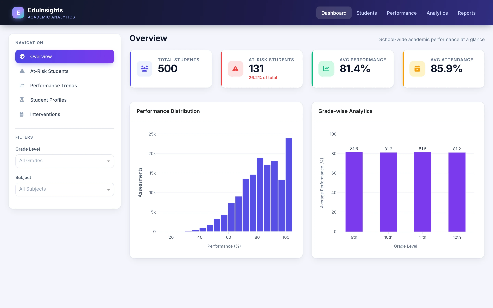
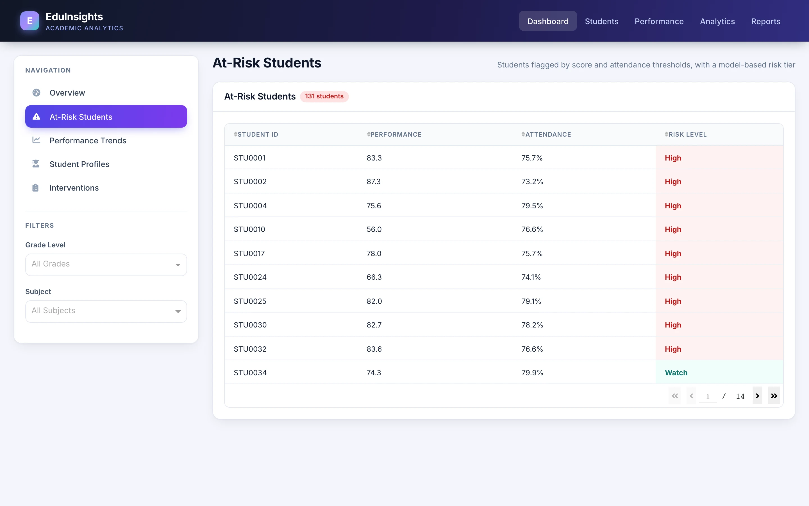
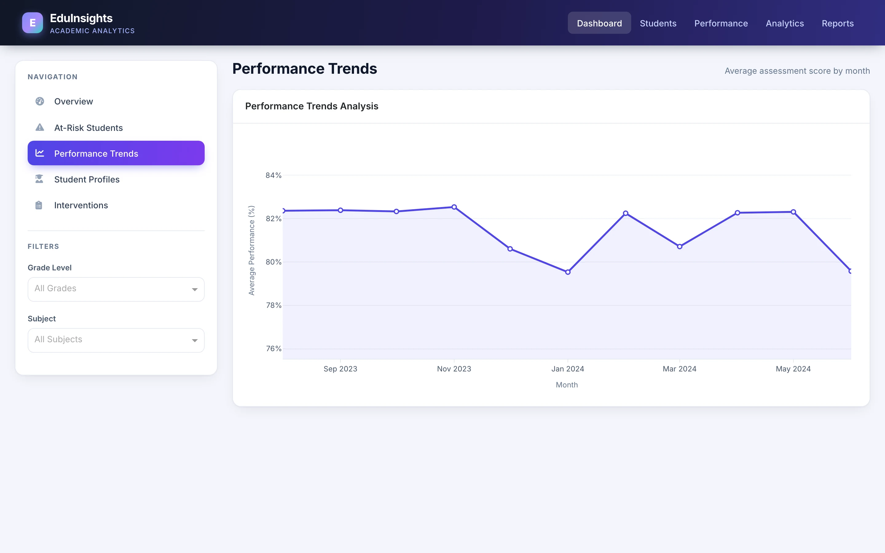
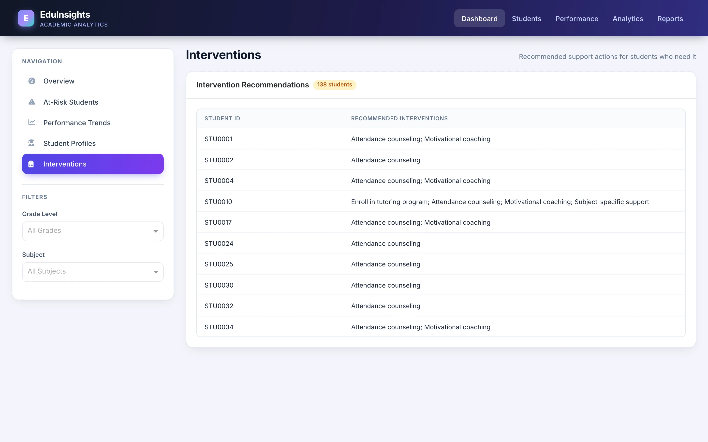
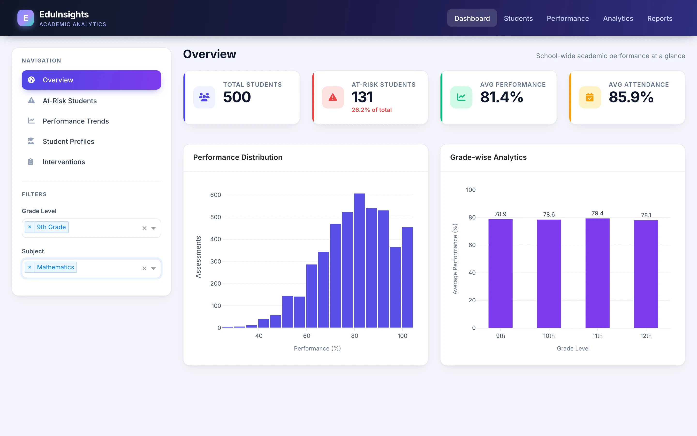
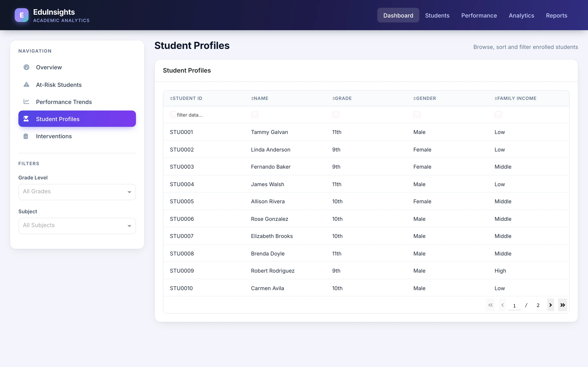

# Edul-Insights

**An academic analytics dashboard that surfaces at-risk students, performance trends and suggested interventions.**

Python · Dash · Plotly · pandas · scikit-learn · SQLite

<table>
  <tr>
    <td></td>
    <td></td>
  </tr>
  <tr>
    <td></td>
    <td></td>
  </tr>
</table>
Screenshots are real captures of a local build running on fictional demo data.

---

## Product at a Glance

| | |
|---|---|
| **What it is** | Single-page analytics dashboard for school performance and attendance |
| **Views** | Overview, At-Risk Students, Performance Trends, Student Profiles, Interventions |
| **Data** | Synthetic: 500 students, 25 teachers, about 148k performance and 119k attendance rows (SQLite, Faker-generated) |
| **Analytics** | RandomForest risk classifier and performance regressor on engineered per-student features |
| **Interaction** | Grade and subject filters on the Overview; sortable, filterable tables |

## Product Showcase

<table>
  <tr>
    <td align="center"> <b>Filtered overview</b> Grade and subject filters</td>
    <td align="center"> <b>Student profiles</b> Sortable, filterable roster</td>
    <td align="center"> <b>Trends</b> Monthly average score</td>
  </tr>
</table>

## Key Features

- **KPI overview.** Total students, at-risk count, average performance and attendance at a glance.
- **Performance charts.** Score distribution histogram and average performance by grade level, filterable by grade and subject.
- **At-risk list.** 131 students flagged when average score is below 60% or attendance below 80%, each with a High / Medium / Watch tier.
- **Trends.** Average assessment score by month across the school year.
- **Profiles and interventions.** A 500-row student table and rule-based support recommendations for 138 students.

## Architecture

SQLite holds students, teachers, performance and attendance. A Faker-based generator populates it. An ML module engineers per-student features, trains and pickles RandomForest models, and the Dash app reads the database and models to render charts and tables through callbacks. See [docs/ARCHITECTURE.md](docs/ARCHITECTURE.md).

## Engineering Highlights

- End-to-end pipeline: synthetic data, feature engineering, model training, dashboard.
- Callback-driven filters that update charts without a page reload.
- Consistent presentation layer: shared chart styling helper, DataTable theme and a CSS asset file.
- Fixes to the original build: an invalid histogram argument, grade ordering, and the missing risk-level column. See [docs/ENGINEERING_CHALLENGES.md](docs/ENGINEERING_CHALLENGES.md).

## Status & Scope

This is a demo build on fictional data, not a production system.

- **Risk flag is rule-based.** A student is at risk if average score is below 60% or attendance below 80%. The RandomForest model is trained on that same rule, so the High / Medium / Watch tier is a probability-based ranking, not independent prediction.
- **Interventions are rule-based text**, not model output.
- **Top navigation links are placeholders.** Navigation works through the sidebar tabs.
- Export and advanced analytics are not available in the UI; one larger ML module is unused.

## Documentation

- [Product overview](docs/PRODUCT_OVERVIEW.md)
- [Technical case study](docs/TECHNICAL_CASE_STUDY.md)
- [Architecture](docs/ARCHITECTURE.md)
- [Engineering challenges](docs/ENGINEERING_CHALLENGES.md)
- [Privacy and source](docs/PRIVACY_AND_SOURCE.md)

## Source Code

The source is private. See [RIGHTS.md](RIGHTS.md) for usage terms.
