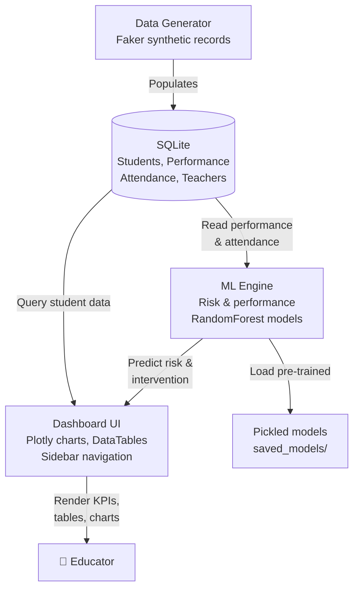

# Architecture

All diagrams describe responsibilities and data flow, not production class names.

## System Overview

The application follows a three-tier structure: data persistence (SQLite), analytical engine (Python scikit-learn models), and interactive UI (Dash + Plotly).

## Data Flow

1. **Data Ingestion:** The Faker generator creates synthetic student, teacher, performance and attendance records and writes them to SQLite; the launcher generates the database only if it is missing, and the dashboard reads it afterwards.

2. **Feature Engineering:** The ML engine reads raw performance and attendance from the database, engineers per-student features (average performance, attendance rate, grade, motivation, study hours and similar) and feeds them to RandomForest models.

3. **Risk Prediction:** The at-risk label is derived from a business rule (average performance < 60% OR attendance < 80%). The RandomForest model learns this rule from historical data, assigning a prediction probability to each student. The dashboard translates probabilities into three risk tiers.

4. **Interventions:** Rule-based text recommendations are generated based on student profile (grade, performance level, attendance pattern) and are displayed alongside at-risk records.

5. **Dashboard Rendering:** Callbacks in Dash respond to user interactions—filter changes, table selections—and refresh charts and tables in real time using Plotly and dash-bootstrap-components.

## Key Components

| Component | Purpose | Tech |
|-----------|---------|------|
| `app.py` | Setup and launcher (creates data and models if missing) | Dash 2.14 |
| `data_generator.py` | Synthetic data creation using Faker | Faker, SQLite |
| `models.py` | ML training and inference for risk/performance | scikit-learn, joblib |
| `dashboard.py` | UI layout and interactive callbacks | Dash, Plotly, dbc |
| `tests.py`, `test_system.py` | Test scripts | unittest |

## Database Schema

**students:** student ID, name, gender, age, grade, section, family background fields, motivation, study hours, enrollment date.  
**teachers:** teacher ID, name, subject, experience, qualification, teaching load.  
**performance:** student, teacher, subject, semester, assessment type and date, score and percentage.  
**attendance:** student, date and attendance status.  

The database holds 148,000 performance records and 119,000 attendance records.

## Model Pipeline

Two scikit-learn RandomForest models are trained and pickled in `saved_models/`:

- **Risk Classifier:** Predicts the binary at-risk label with a probability, from demographic and engagement features such as grade, gender, family income, motivation, study hours and attendance rate.
- **Performance Regressor:** Predicts average performance. It is trained and saved but is not used by the dashboard views.

Models are loaded from the pickles at dashboard startup rather than retrained per request.
